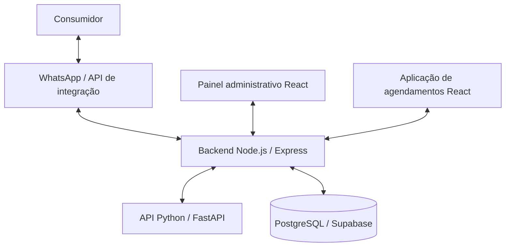

# Chatbot PROCON — Sistema Inteligente de Atendimento ao Consumidor

<p align="left">
  Sistema inteligente de interação com o usuário com orientações e serviços prestados pelo órgão PROCON  
</p>


## Visão geral

O **Chatbot PROCON** é uma solução de atendimento e orientação ao consumidor, desenvolvida com o objetivo de facilitar o acesso às informações e aos serviços do PROCON.

A proposta consiste em disponibilizar um chatbot integrado ao WhatsApp, capaz de receber mensagens, identificar a necessidade do consumidor, conduzir fluxos de atendimento e apresentar orientações fundamentadas em informações oficiais.

Quando a situação não puder ser resolvida por meio da orientação automatizada, o sistema deverá permitir o encaminhamento para atendimento presencial, incluindo a consulta de disponibilidade, o agendamento e a indicação dos documentos necessários.

O projeto também contempla uma interface administrativa destinada aos funcionários do PROCON, permitindo a consulta de agendamentos e, conforme a implementação, o acesso às informações relevantes dos atendimentos.

## Problema identificado

O atendimento presencial pode envolver dúvidas recorrentes, dificuldades de acesso à informação, necessidade de triagem e deslocamentos que poderiam ser evitados por meio de uma orientação inicial.

A ausência de um canal automatizado e estruturado pode dificultar a organização dos atendimentos e aumentar o tempo necessário para que o consumidor encontre informações sobre seus direitos e os procedimentos disponíveis.

## Solução proposta

Desenvolver um sistema que integre:

- Atendimento automatizado pelo WhatsApp.
- Identificação e gerenciamento de sessões.
- Categorização das solicitações.
- Fluxos decisórios de orientação.
- Consulta a uma base de conhecimento.
- Apoio de inteligência artificial.
- Encaminhamento para atendimento presencial.
- Consulta e registro de agendamentos.
- Interface administrativa para funcionários.
- Registro e análise de atendimentos.
- Testes automatizados e integração contínua.

## Objetivo geral

Desenvolver uma solução digital de atendimento ao consumidor que auxilie na orientação inicial, organize informações e contribua para tornar os processos de atendimento do PROCON mais acessíveis e eficientes.

## Objetivos específicos

- Facilitar o acesso às orientações iniciais.
- Reduzir a necessidade de deslocamentos para esclarecimento de dúvidas simples.
- Organizar os atendimentos por categorias.
- Disponibilizar informações baseadas em fontes oficiais.
- Apoiar a realização de agendamentos presenciais.
- Disponibilizar informações relevantes aos funcionários.
- Preservar o contexto das interações.
- Aplicar práticas de segurança e proteção de dados.
- Garantir a qualidade do software por meio de testes e revisão de código.
- Documentar os componentes e os processos de desenvolvimento.

---

## Escopo do projeto

## Público-alvo

| Público | Necessidade |
|---|---|
| Consumidores | Receber orientações e solicitar atendimento |
| Funcionários do PROCON | Consultar agendamentos e informações de atendimento |
| Administradores | Gerenciar informações e apoiar a manutenção do sistema |

## Funcionalidades previstas

| Módulo | Responsabilidade |
|---|---|
| WhatsApp | Comunicação com o consumidor |
| Chatbot | Gerenciamento da interação e das respostas |
| Sessões | Identificação e continuidade do atendimento |
| Fluxos decisórios | Direcionamento das perguntas e orientações |
| Inteligência Artificial | Apoio à classificação e à recuperação de informações |
| Base de conhecimento | Armazenamento de informações de referência |
| Agendamentos | Consulta e registro de horários |
| Painel administrativo | Consulta e acompanhamento dos atendimentos |
| Persistência | Armazenamento de informações necessárias |
| Qualidade | Testes, validações e integração contínua |

## Escopo do MVP

O Produto Mínimo Viável prioriza o atendimento inicial, a orientação ao consumidor, a integração entre os serviços essenciais e a disponibilização de um fluxo demonstrável.

Funcionalidades complementares, como aprendizado contínuo supervisionado, gerenciamento avançado de conhecimento e automações adicionais, devem ser avaliadas conforme o prazo, os critérios de aceitação e as entregas efetivamente realizadas.

---

## Tecnologias utilizadas

## Stack tecnológica

| Camada | Tecnologia | Finalidade |
|---|---|---|
| Frontend | React | Construção das interfaces |
| Frontend | TypeScript | Tipagem e manutenção do código |
| Frontend | Vite | Desenvolvimento e build |
| Backend | Node.js | Ambiente de execução |
| Backend | Express | Construção da API |
| Backend | TypeScript | Desenvolvimento tipado |
| Inteligência Artificial | Python | Implementação de funcionalidades de IA |
| API de IA | FastAPI | Disponibilização de endpoints Python |
| Banco de dados | PostgreSQL | Persistência relacional |
| Banco de dados | Supabase | Infraestrutura de banco de dados |
| Testes | Vitest | Execução de testes automatizados |
| Containerização | Docker | Padronização de ambientes |
| Versionamento | Git e GitHub | Controle de versões e colaboração |
| Integração contínua | GitHub Actions | Validação automatizada |
| Hospedagem frontend | Vercel | Publicação das interfaces |
| Hospedagem de APIs | Render | Publicação dos serviços |

## Ferramentas de desenvolvimento

<p>
  
</p>

## Integrações externas

O sistema foi planejado para utilizar uma API compatível com WhatsApp para o envio e recebimento de mensagens.

A integração deve ser configurada por meio de credenciais e variáveis de ambiente, sem expor informações sensíveis no repositório.

O funcionamento completo dessa integração deve ser validado em ambiente autorizado de testes.

---

## Arquitetura do sistema

O projeto adota uma arquitetura modular, com separação de responsabilidades entre as interfaces, a API principal, o serviço de inteligência artificial e a camada de persistência.

## Visão arquitetural



O diagrama apresenta a arquitetura lógica pretendida. As conexões e integrações devem ser conferidas com o código implementado antes da entrega final.

## Responsabilidades

**Frontend:** disponibiliza interfaces para interação com os módulos Web.

**Backend:** centraliza endpoints, regras de negócio, validações e integração entre serviços.

**API Python:** oferece funcionalidades relacionadas ao processamento de informações e inteligência artificial.

**Banco de dados:** mantém os registros persistentes utilizados pela aplicação.

**Integração WhatsApp:** permite a troca de mensagens entre o consumidor e o sistema.

## Princípios arquiteturais

- Separação de responsabilidades.
- Modularidade.
- Baixo acoplamento entre componentes.
- Uso de APIs para comunicação.
- Configuração por variáveis de ambiente.
- Validação de entradas.
- Tratamento de erros.
- Facilidade de manutenção e testes.

---

## Organização do repositório

Repositório oficial:

https://github.com/HighTechDSM/ABP_6_DSM

Os diretórios principais identificados na organização do projeto incluem:

| Diretório ou arquivo | Finalidade |
|---|---|
| `backend/` | API principal e testes do backend |
| `docker/` | Configurações relacionadas à containerização |
| `.github/workflows/` | Workflows de integração contínua |
| `README.md` | Documentação principal |

---

## Instalação e execução local

## Clonar o repositório

```bash
git clone https://github.com/HighTechDSM/ABP_6_DSM.git
cd ABP_6_DSM
```

## Selecionar a branch de desenvolvimento

```bash
git switch develop
git pull origin develop
```

A branch `develop` é utilizada como referência para integração das alterações em desenvolvimento.

Para reproduzir uma entrega específica, utilize a branch ou tag correspondente à versão apresentada.

## Instalar as dependências do backend

```bash
cd backend
npm ci
```

## Configurar as variáveis de ambiente

As configurações devem ser fornecidas por variáveis de ambiente, conforme as necessidades de cada serviço.

Não devem ser adicionados ao repositório:

- Senhas de banco de dados.
- Tokens de autenticação.
- Chaves privadas.
- Credenciais do WhatsApp.
- Credenciais de produção.
- Arquivos `.env` contendo segredos.

Recomenda-se disponibilizar arquivos `.env.example` sem valores sensíveis.

## Executar os serviços

A execução local exige iniciar os componentes necessários para o cenário que será testado.

Consulte os scripts definidos nos respectivos arquivos `package.json` e a configuração do serviço Python.

Não se deve presumir que um único comando inicialize todos os componentes da solução.

---


---

# Executando o Projeto com Docker

## Pré-requisitos

Antes de executar o projeto, é necessário ter o **Docker Desktop** instalado e em execução.

## Construir a imagem Docker

Na raiz do projeto, execute:

```bash
docker compose -f docker/docker-compose.yml build
```

Esse comando cria a imagem do frontend utilizando o Dockerfile localizado em:

```text
docker/frontend/Dockerfile
```

Durante a construção da imagem, as dependências do projeto são instaladas automaticamente por meio do comando `npm ci`.

## Iniciar o container

Após a construção da imagem, execute:

```bash
docker compose -f docker/docker-compose.yml up
```

O Docker irá criar e iniciar o container do frontend.

Quando o Vite estiver pronto, será exibida uma mensagem semelhante a:

```text
VITE ... ready

Local: http://localhost:5173/
```

## Acessar a aplicação

Com o container em execução, abra o navegador e acesse:

**http://localhost:5173**

A aplicação estará sendo executada dentro do container Docker.

## Verificar o container

Para verificar se o container está em execução, abra outro terminal e execute:

```bash
docker compose -f docker/docker-compose.yml ps
```

O serviço `frontend` deverá apresentar um status semelhante a:

```text
Up
```

A porta deverá estar configurada como:

```text
0.0.0.0:5173->5173/tcp
```

## Encerrar o ambiente

Para parar e remover o container e a rede criada pelo Docker Compose, execute:

```bash
docker compose -f docker/docker-compose.yml down
```

---

## Ambientes de demonstração

Os seguintes endereços foram utilizados no desenvolvimento e nos testes do projeto.

| Serviço | Endereço |
|---|---|
| Interface do chatbot | https://abp-6-dsm-fa8e.vercel.app/ |
| Aplicação de agendamentos | https://abp-6-dsm.vercel.app/ |
| Backend | https://abp-6-dsm.onrender.com/api/health |
| API Python | https://api-python-7l6j.onrender.com/ |
| Documentação da API Python | https://api-python-7l6j.onrender.com/docs |

---

## Banco de dados e base de conhecimento

## Persistência

O projeto utiliza PostgreSQL/Supabase para persistência de dados.

A aplicação deve manter uma separação adequada entre os ambientes de desenvolvimento, testes e produção.

Os testes automatizados não devem modificar dados reais de consumidores.

### 10.2 Base de conhecimento

A base de conhecimento foi planejada para armazenar informações utilizadas pelo chatbot durante a orientação ao consumidor.

Seu conteúdo deve ser fundamentado nas informações e nos documentos oficiais disponibilizados para o projeto.

As informações podem incluir:

- Categorias de atendimento.
- Perguntas frequentes.
- Respostas e orientações.
- Documentos necessários.
- Referências de origem.
- Situação de validação do conhecimento.

## Atualização e validação

A incorporação de novos conhecimentos deve respeitar o processo de validação previsto nos requisitos RF15, RF16 e RP09.

O aprendizado contínuo não deve ser confundido com a publicação automática de respostas geradas a partir de conversas anteriores.

Conteúdos ainda não validados não devem ser apresentados como orientações oficiais.

---

## Testes automatizados

O projeto utiliza Vitest para executar testes do backend.

As suítes são organizadas em configurações distintas para evitar a mistura de testes rápidos com verificações que dependem de serviços externos.

## Testes convencionais

```bash
cd backend
npm test
```

Configuração:

```text
backend/vitest.config.ts
```

A suíte principal foi organizada para excluir os testes de integração com banco de dados e os testes E2E.

## Testes de integração

```bash
cd backend
npx vitest run --config vitest.integration.config.ts
```

Configuração:

```text
backend/vitest.integration.config.ts
```

Esses testes dependem de um ambiente de banco de dados apropriado.

A configuração de testes deve utilizar credenciais específicas e isoladas.

## Testes E2E

```bash
cd backend
npx vitest run --config vitest.e2e.config.ts
```

Configuração:

```text
backend/vitest.e2e.config.ts
```

Os cenários E2E implementados incluem verificações relacionadas aos serviços publicados e aos endpoints da API.

## Resultados de referência

Durante a validação da separação das suítes, foram registrados os seguintes resultados locais:

| Suíte | Testes aprovados |
|---|---:|
| Convencional | 27 |
| Integração com banco | 11 |
| E2E | 7 |

---

## Integração contínua e CI/CD

O projeto utiliza GitHub Actions para automatizar verificações de qualidade.

## Localização

```text
.github/workflows/ci.yml
```

## Verificações previstas

| Job | Responsabilidade |
|---|---|
| Backend | Executar validações e testes do backend |
| Frontend | Validar a aplicação frontend |
| Supabase Integration | Executar testes de integração com banco de testes |
| E2E Smoke | Executar verificações E2E quando acionadas |

A disponibilidade de cada job depende da configuração do workflow na branch utilizada.

## Execução automática

Os workflows podem ser acionados conforme os eventos configurados no GitHub Actions.

A configuração deve ser consultada no arquivo YAML para confirmar os gatilhos efetivamente ativos.

## Execução manual

Os testes E2E foram organizados para permitir execução separada.

O botão de execução manual no GitHub Actions depende da presença de `workflow_dispatch` na configuração do workflow disponível na branch padrão.

## Segredos

As credenciais necessárias aos testes devem ser configuradas nos GitHub Actions Secrets.

Exemplos de configurações utilizadas:

```text
TEST_DATABASE_URL
DATABASE_SSL
```

Os valores reais não devem aparecer no código, no README ou nos logs publicados.

## Evidências

As evidências de execução devem ser consultadas em:

https://github.com/HighTechDSM/ABP_6_DSM/actions

Para fins de avaliação, recomenda-se registrar o workflow, a branch, o commit, a data e o resultado da execução.

---
## Requisitos do projeto

## Requisitos funcionais

| ID | Requisito | Descrição |
|---|---|---|
| RF01 | Atendimento via WhatsApp | Permitir que o consumidor inicie e realize o atendimento por meio do WhatsApp. |
| RF02 | Identificação e sessão | Identificar o consumidor e manter o contexto da sessão. |
| RF03 | Menus e categorias | Apresentar categorias para direcionamento do atendimento. |
| RF04 | Fluxos decisórios | Conduzir o consumidor por perguntas e alternativas sequenciais. |
| RF05 | Orientação ao consumidor | Apresentar orientações e próximos passos. |
| RF06 | Registro das interações | Registrar mensagens, respostas e etapas do atendimento. |
| RF07 | Encaminhamento presencial | Oferecer atendimento presencial quando necessário. |
| RF08 | Agendamento via WhatsApp | Permitir consulta de horários e realização de agendamentos. |
| RF09 | Documentos necessários | Informar os documentos recomendados para o atendimento. |
| RF10 | Gestão de atendimentos | Permitir a consulta de atendimentos pelos funcionários. |
| RF11 | Contexto da conversa | Permitir consulta ao contexto do atendimento realizado pelo chatbot. |
| RF12 | Lembretes de atendimento | Enviar lembretes sobre atendimentos próximos. |
| RF13 | Base de conhecimento | Utilizar informações e documentos oficiais. |
| RF14 | Casos fora do escopo | Identificar situações fora da atuação do PROCON. |
| RF15 | Aprendizado contínuo | Analisar atendimentos para identificar oportunidades de melhoria. |
| RF16 | Validação de conhecimento | Validar novos conhecimentos antes de incorporá-los à base. |

## Requisitos não funcionais

| ID | Requisito | Descrição |
|---|---|---|
| RNF01 | Usabilidade | Utilizar linguagem clara, objetiva e compreensível. |
| RNF02 | Desempenho | Apresentar tempos de resposta adequados. |
| RNF03 | Segurança e LGPD | Aplicar práticas de segurança e proteção de dados. |
| RNF04 | Caráter orientativo | Informar que as respostas não substituem o atendimento formal. |
| RNF05 | Transparência da IA | Informar quando houver utilização de recursos de IA. |
| RNF06 | Containerização | Permitir execução utilizando Docker. |
| RNF07 | Documentação | Documentar instalação, configuração, arquitetura e utilização. |
| RNF08 | Qualidade de software | Utilizar versionamento, testes, revisão de código e integração contínua. |
| RNF09 | Disponibilidade | Manter disponibilidade adequada dos serviços de atendimento. |

## Restrições do projeto

| ID | Restrição | Descrição |
|---|---|---|
| RP01 | Integração WhatsApp | Utilizar API compatível com WhatsApp. |
| RP02 | Backend Web | Utilizar tecnologia adequada a aplicações Web modernas. |
| RP03 | Arquitetura modular | Separar os módulos e suas responsabilidades. |
| RP04 | MVP | Priorizar funcionalidades essenciais ao semestre. |
| RP05 | IA sem API externa de LLM | Não depender de API externa de LLM como mecanismo principal. |
| RP06 | WhatsApp como canal principal | Concentrar o atendimento do consumidor no WhatsApp. |
| RP07 | Base oficial | Utilizar documentos e informações oficiais como fonte inicial. |
| RP08 | Painel Web | Disponibilizar interface administrativa para funcionários. |
| RP09 | Aprendizado supervisionado | Exigir validação antes da incorporação de novos conhecimentos. |
| RP10 | Contexto do atendimento | Disponibilizar contexto da conversa associado ao agendamento. |

---

## Product Backlog

O Product Backlog apresenta as necessidades identificadas para o produto.

| ID | Requisito | User Story resumida | Prioridade |
|---|---|---|---|
| PB01 | RF01 | Iniciar atendimento pelo WhatsApp | Alta |
| PB02 | RF01 | Interagir com o chatbot | Alta |
| PB03 | RF02 | Identificar o consumidor | Alta |
| PB04 | RF02 | Manter o contexto da sessão | Alta |
| PB05 | RP01 | Receber mensagens pela API do WhatsApp | Alta |
| PB06 | RP01 | Enviar respostas pela API do WhatsApp | Alta |
| PB07 | RF03 | Visualizar categorias | Alta |
| PB08 | RF03 | Selecionar categoria | Alta |
| PB09 | RF04 | Responder perguntas sequenciais | Alta |
| PB10 | RF04 | Controlar etapa do fluxo | Alta |
| PB11 | RF04 | Apresentar perguntas relacionadas às respostas | Alta |
| PB12 | RF04 | Determinar próxima pergunta | Alta |
| PB13 | RF05 | Receber orientação consolidada | Alta |
| PB14 | RF05 | Receber próximos passos | Alta |
| PB15 | RF14 | Identificar casos fora do escopo | Alta |
| PB16 | RNF01 | Receber mensagens claras | Alta |
| PB17 | RNF04 | Informar caráter orientativo | Alta |
| PB18 | RNF05 | Informar uso de IA | Média |
| PB19 | RF13 | Utilizar informações oficiais | Alta |
| PB20 | RF13 | Armazenar perguntas e respostas | Alta |
| PB21 | RF13 | Atualizar base de conhecimento | Média |
| PB22 | RP07 | Estruturar documento de dúvidas frequentes | Alta |
| PB23 | RF07 | Encaminhar para atendimento presencial | Alta |
| PB24 | RF08 | Consultar datas disponíveis | Alta |
| PB25 | RF08 | Consultar horários disponíveis | Alta |
| PB26 | RF08 | Agendar pelo WhatsApp | Alta |
| PB27 | RF08 | Confirmar agendamento | Alta |
| PB28 | RF09 | Consultar documentos necessários | Alta |
| PB29 | RF12 | Receber lembrete | Média |
| PB30 | RF10 | Consultar atendimentos atribuídos | Alta |
| PB31 | RF10 | Consultar dados do consumidor | Alta |
| PB32 | RF10 | Consultar data e horário | Alta |
| PB33 | RF11 | Visualizar contexto da conversa | Alta |
| PB34 | RF11 | Visualizar respostas do consumidor | Alta |
| PB35 | RF11 | Visualizar motivo do encaminhamento | Alta |
| PB36 | RF06 | Registrar interações | Alta |
| PB37 | RF06 | Registrar resultado do atendimento | Alta |
| PB38 | RF15 | Identificar casos relevantes | Média |
| PB39 | RF15 | Analisar casos não solucionados | Média |
| PB40 | RF16 | Validar conhecimentos | Alta |
| PB41 | RP09 | Impedir incorporação sem validação | Alta |
| PB42 | RNF03 | Proteger dados pessoais | Alta |
| PB43 | RNF02 | Garantir resposta em tempo adequado | Alta |
| PB44 | RNF06 | Executar com Docker | Alta |
| PB45 | RNF07 | Documentar instalação | Alta |
| PB46 | RNF08 | Versionar o código | Alta |
| PB47 | RNF08 | Criar testes automatizados | Alta |
| PB48 | RNF08 | Revisar código | Média |
| PB49 | RNF08 | Utilizar integração contínua | Média |
| PB50 | RP02 | Definir tecnologia do backend | Alta |
| PB51 | RP03 | Separar módulos | Alta |
| PB52 | RP03 | Desacoplar integração WhatsApp | Alta |
| PB53 | RP04 | Priorizar MVP | Alta |
| PB54 | RP05 | Evitar dependência principal de LLM externa | Alta |
| PB55 | RP06 | Concentrar atendimento no WhatsApp | Alta |
| PB56 | RP08 | Utilizar painel Web | Alta |
| PB57 | RP10 | Associar contexto ao agendamento | Alta |

---

## User Stories

### US01 — Iniciar atendimento

**Como** consumidor, **quero** iniciar uma conversa pelo WhatsApp **para** obter orientação sem precisar comparecer inicialmente ao PROCON.

**Critérios de aceitação:**

- [ ] O consumidor consegue iniciar a conversa pelo canal configurado.
- [ ] O sistema recebe a mensagem.
- [ ] Uma sessão é criada quando necessário.
- [ ] O chatbot apresenta a mensagem inicial.
- [ ] O caráter orientativo é informado.
- [ ] O consumidor consegue iniciar o fluxo.

### US02 — Identificar usuário e sessão

**Como** consumidor, **quero** que o sistema reconheça minha sessão **para** continuar a conversa sem perder o contexto.

**Critérios de aceitação:**

- [ ] O consumidor é identificado.
- [ ] O sistema verifica sessões ativas.
- [ ] Uma sessão é criada quando necessário.
- [ ] Sessões existentes podem ser recuperadas.
- [ ] As mensagens são associadas à sessão correta.
- [ ] O contexto é preservado.

### US03 — Selecionar categoria do problema

**Como** consumidor, **quero** selecionar uma categoria **para** ser direcionado ao fluxo adequado.

**Critérios de aceitação:**

- [ ] As categorias disponíveis são apresentadas.
- [ ] As categorias possuem referência nas informações do projeto.
- [ ] O consumidor consegue selecionar uma categoria.
- [ ] A seleção é associada à sessão.
- [ ] O fluxo correspondente é iniciado.

### US04 — Navegar pelo fluxo decisório

**Como** consumidor, **quero** responder às perguntas do chatbot **para** receber uma orientação adequada.

**Critérios de aceitação:**

- [ ] O chatbot apresenta perguntas.
- [ ] As alternativas são apresentadas quando aplicável.
- [ ] Cada resposta direciona à etapa correta.
- [ ] O estado do fluxo é mantido.
- [ ] O fluxo possui uma condição de encerramento.

### US05 — Responder perguntas condicionais

**Como** consumidor, **quero** receber perguntas relacionadas às minhas respostas anteriores **para** fornecer apenas as informações necessárias.

**Critérios de aceitação:**

- [ ] As respostas anteriores são consideradas.
- [ ] A próxima pergunta segue as regras do fluxo.
- [ ] Caminhos alternativos são suportados.
- [ ] Perguntas desnecessárias são evitadas.
- [ ] O contexto é mantido.

### US06 — Receber orientação

**Como** consumidor, **quero** receber uma orientação consolidada **para** compreender quais medidas posso tomar.

**Critérios de aceitação:**

- [ ] O resultado do fluxo é identificado.
- [ ] Uma orientação relacionada ao caso é apresentada.
- [ ] Os próximos passos são informados.
- [ ] A linguagem é clara.
- [ ] O caráter orientativo é informado.
- [ ] O encaminhamento presencial é indicado quando necessário.

### US07 — Consultar informações da base de conhecimento

**Como** consumidor, **quero** receber respostas baseadas em informações oficiais **para** obter orientações confiáveis.

**Critérios de aceitação:**

- [ ] O chatbot consulta a base quando necessário.
- [ ] As informações possuem origem identificável.
- [ ] As respostas são relacionadas à solicitação.
- [ ] O conteúdo pode ser atualizado pela equipe responsável.
- [ ] Conteúdos não validados não são apresentados como oficiais.

### US08 — Identificar caso fora do escopo

**Como** consumidor, **quero** saber quando meu problema não pertence à atuação do PROCON **para** evitar orientações inadequadas.

**Critérios de aceitação:**

- [ ] O sistema identifica casos não contemplados.
- [ ] O consumidor recebe uma informação clara.
- [ ] Não são apresentadas orientações oficiais sem base validada.
- [ ] Próximos passos são indicados quando possível.

### US09 — Solicitar atendimento presencial

**Como** consumidor, **quero** solicitar atendimento presencial **para** obter ajuda quando a orientação automatizada não for suficiente.

**Critérios de aceitação:**

- [ ] A necessidade de atendimento presencial é identificada.
- [ ] O agendamento é oferecido.
- [ ] O processo pode ser iniciado pelo WhatsApp.
- [ ] O contexto necessário é associado ao agendamento.
- [ ] Não é necessário acessar outra aplicação para agendar.

### US10 — Consultar datas e horários disponíveis

**Como** consumidor, **quero** visualizar datas e horários disponíveis **para** escolher quando serei atendido.

**Critérios de aceitação:**

- [ ] Datas disponíveis são apresentadas.
- [ ] O consumidor seleciona uma data.
- [ ] Horários correspondentes são apresentados.
- [ ] Horários indisponíveis não podem ser selecionados.
- [ ] A disponibilidade é atualizada após agendamentos.

### US11 — Realizar agendamento

**Como** consumidor, **quero** realizar meu agendamento pelo WhatsApp **para** garantir um horário de atendimento.

**Critérios de aceitação:**

- [ ] Data e horário podem ser selecionados.
- [ ] Os dados necessários são solicitados.
- [ ] Os dados são validados.
- [ ] O agendamento é registrado.
- [ ] Conflitos de horário são impedidos.
- [ ] Uma confirmação é enviada.
- [ ] O fluxo é encerrado adequadamente.

### US12 — Consultar documentos necessários

**Como** consumidor, **quero** saber quais documentos apresentar **para** comparecer preparado ao atendimento.

**Critérios de aceitação:**

- [ ] Os documentos relacionados ao caso são identificados.
- [ ] As informações são organizadas.
- [ ] O consumidor recebe a orientação pelo WhatsApp.
- [ ] A possibilidade de documentos adicionais é informada.
- [ ] As informações são associadas ao contexto.

### US13 — Receber lembrete do atendimento

**Como** consumidor, **quero** receber um lembrete **para** não esquecer meu agendamento.

**Critérios de aceitação:**

- [ ] Agendamentos próximos são identificados.
- [ ] Um lembrete é enviado.
- [ ] Data e horário são informados.
- [ ] Informações adicionais podem ser incluídas.
- [ ] Envios duplicados são evitados.

### US14 — Visualizar meus agendamentos

**Como** funcionário do PROCON, **quero** visualizar os atendimentos sob minha responsabilidade **para** organizar minha rotina.

**Critérios de aceitação:**

- [ ] O painel Web pode ser acessado.
- [ ] Os atendimentos atribuídos são apresentados.
- [ ] A visualização por data está disponível.
- [ ] Horário, consumidor e status são apresentados.
- [ ] As regras de acesso são respeitadas.

### US15 — Consultar dados do atendimento

**Como** funcionário do PROCON, **quero** consultar os dados do consumidor e do agendamento **para** me preparar para o atendimento.

**Critérios de aceitação:**

- [ ] Os dados necessários podem ser consultados.
- [ ] Data e horário são apresentados.
- [ ] O caso é identificado.
- [ ] Os documentos podem ser consultados.
- [ ] O acesso respeita as regras de privacidade.

### US16 — Visualizar contexto da conversa

**Como** funcionário do PROCON, **quero** visualizar o contexto da conversa **para** compreender previamente o problema.

**Critérios de aceitação:**

- [ ] O contexto está associado ao agendamento.
- [ ] Perguntas e respostas podem ser consultadas.
- [ ] A categoria selecionada é apresentada.
- [ ] O fluxo percorrido pode ser identificado.
- [ ] A orientação fornecida pode ser consultada.
- [ ] O motivo do encaminhamento é apresentado.
- [ ] O acesso é protegido.

### US17 — Registrar atendimentos

**Como** responsável pelo sistema, **quero** registrar os atendimentos **para** analisar casos e identificar melhorias.

**Critérios de aceitação:**

- [ ] Interações podem ser registradas.
- [ ] Perguntas e respostas podem ser armazenadas.
- [ ] O fluxo percorrido pode ser identificado.
- [ ] O resultado do atendimento é registrado.
- [ ] Casos solucionados e encaminhados são distinguíveis.
- [ ] A proteção dos dados é respeitada.

### US18 — Analisar casos para aprimoramento

**Como** responsável pelo sistema, **quero** analisar os atendimentos **para** identificar padrões e dúvidas não contempladas.

**Critérios de aceitação:**

- [ ] Atendimentos podem ser consultados.
- [ ] Casos semelhantes podem ser identificados.
- [ ] Dúvidas não solucionadas podem ser identificadas.
- [ ] Encaminhamentos presenciais podem ser analisados.
- [ ] Casos relevantes podem ser selecionados.
- [ ] A privacidade dos dados é respeitada.

### US19 — Selecionar casos relevantes

**Como** responsável pela base de conhecimento, **quero** selecionar atendimentos relevantes **para** avaliar oportunidades de melhoria.

**Critérios de aceitação:**

- [ ] Existem critérios de seleção.
- [ ] Casos não solucionados podem ser identificados.
- [ ] Casos recorrentes podem ser identificados.
- [ ] Situações fora dos fluxos podem ser identificadas.
- [ ] Casos selecionados ficam disponíveis para avaliação.
- [ ] A seleção não incorpora automaticamente conhecimento à base.

### US20 — Validar novos conhecimentos

**Como** responsável pela base de conhecimento, **quero** validar novos conteúdos **para** garantir orientações confiáveis.

**Critérios de aceitação:**

- [ ] Conteúdos podem ser submetidos à validação.
- [ ] A origem é identificável.
- [ ] Conteúdos podem ser aprovados ou rejeitados.
- [ ] Apenas conteúdos aprovados são incorporados.
- [ ] A validação é registrada.
- [ ] Conteúdos pendentes não são utilizados como oficiais.

### US21 — Incorporar novos conhecimentos à base

**Como** responsável pela base de conhecimento, **quero** incorporar conteúdos validados **para** melhorar os atendimentos futuros.

**Critérios de aceitação:**

- [ ] Conteúdos aprovados podem ser incorporados.
- [ ] O conhecimento pode ser associado a categorias.
- [ ] O conhecimento pode ser associado a fluxos.
- [ ] A origem pode ser consultada.
- [ ] A atualização é registrada.
- [ ] O chatbot utiliza a versão validada.

### US22 — Identificar utilização de IA

**Como** consumidor, **quero** saber quando uma resposta recebeu auxílio de IA **para** compreender como ela foi produzida.

**Critérios de aceitação:**

- [ ] O uso de IA pode ser identificado.
- [ ] O consumidor é informado conforme as regras definidas.
- [ ] A informação é apresentada claramente.
- [ ] A transparência não prejudica a orientação.

### US23 — Proteger os dados do consumidor

**Como** consumidor, **quero** que meus dados sejam tratados com segurança **para** proteger minhas informações pessoais.

**Critérios de aceitação:**

- [ ] Apenas os dados necessários são coletados.
- [ ] O acesso é controlado.
- [ ] Dados pessoais não são utilizados indevidamente.
- [ ] Informações sensíveis recebem proteção adequada.
- [ ] Os registros seguem as regras de privacidade.

---

## Definition of Done

Uma tarefa ou User Story será considerada concluída quando os critérios aplicáveis forem atendidos e houver evidências verificáveis.

## Checklist de conclusão

- [ ] Implementação concluída.
- [ ] Código versionado no GitHub.
- [ ] Padrões de desenvolvimento respeitados.
- [ ] Critérios de aceitação atendidos.
- [ ] Testes relevantes executados.
- [ ] Nenhum erro crítico conhecido.
- [ ] Revisão de código realizada.
- [ ] Integração com a aplicação validada.
- [ ] Documentação atualizada.
- [ ] Pull Request revisado e integrado.
- [ ] Evidências associadas à tarefa.
- [ ] Funcionalidade demonstrada ou validada pela equipe.

## Evidências recomendadas

- Pull Request relacionado.
- Commit ou conjunto de commits.
- Execução do GitHub Actions.
- Resultado de testes.
- Capturas de tela.
- Registro da Sprint Review.
- Aprovação dos critérios de aceitação.

---

# SPRINTS

| Sprint | Data de Início | Data de Entrega | Status        |
|--------|----------------|-----------------|---------------|
|  1     | (10/08/2026)   | (14/09/2026)    |  Concluída    |
|  2     | (15/09/2026)   | (19/10/2026)    |  Concluída    |
|  3     | (20/10/2026)   | (23/11/2026)    |  Em andamento |

---

## Sprint Backlog

As tabelas a seguir preservam os identificadores ABP existentes no planejamento.

As associações entre requisitos e User Stories foram revisadas para refletir as definições apresentadas neste README.

Essas correções documentais devem ser sincronizadas com as Issues correspondentes no GitHub Projects.

## Sprint 1 — Fundação do projeto

| ID | Requisito | User Story | Tarefa | Prioridade |
|---|---|---|---|---|
| ABP-001 | RP02/RP03 | — | Definir arquitetura geral da aplicação | Alta |
| ABP-002 | RP02 | — | Definir tecnologias do backend | Alta |
| ABP-003 | RP03 | — | Definir separação entre módulos do sistema | Alta |
| ABP-004 | RP03 | — | Definir comunicação entre os módulos | Alta |
| ABP-005 | RNF06 | — | Configurar ambiente Docker | Alta |
| ABP-006 | RNF08 | — | Configurar repositório do projeto | Alta |
| ABP-007 | RNF08 | — | Definir estratégia de versionamento | Alta |
| ABP-008 | RNF08 | — | Definir padrão de branches | Alta |
| ABP-009 | RNF08 | — | Configurar integração contínua inicial | Média |
| ABP-010 | RP02 | — | Criar estrutura inicial do backend | Alta |
| ABP-011 | RP02 | — | Configurar variáveis de ambiente | Alta |
| ABP-012 | RP08/RF10 | US14 | Implementar filtros de atendimento | Alta |
| ABP-013 | RP08 | US14 | Definir arquitetura do painel administrativo | Alta |
| ABP-014 | RP08 | US14 | Definir layout da interface administrativa | Alta |
| ABP-015 | RP08/RF10 | US14 | Criar tela de agendamentos | Alta |
| ABP-016 | RF10 | US14 | Implementar visualização por data | Alta |
| ABP-017 | RP01 | US01 | Implementar tratamento de mensagens recebidas | Alta |
| ABP-018 | RF01 | US01 | Criar mensagem inicial do chatbot | Alta |
| ABP-019 | RNF04 | US01 | Implementar aviso de caráter orientativo | Alta |
| ABP-020 | RF08 | US10 | Criar modelo de disponibilidade | Alta |
| ABP-021 | RF02 | US02 | Criar modelo de sessão | Alta |
| ABP-022 | RF02 | US02 | Implementar criação de sessão | Alta |
| ABP-023 | RF08 | US10 | Implementar cadastro de datas disponíveis | Alta |
| ABP-024 | RF08 | US10 | Implementar cadastro de horários disponíveis | Alta |
| ABP-025 | RF03 | US03 | Definir categorias iniciais de problemas | Alta |
| ABP-026 | RF03 | US03 | Criar estrutura de categorias | Alta |
| ABP-027 | RF03 | US03 | Implementar consulta de categorias | Alta |
| ABP-028 | RF08 | US11 | Criar modelo de agendamento | Alta |
| ABP-029 | RF04 | US04 | Definir estrutura dos fluxos decisórios | Alta |
| ABP-030 | RF04 | US04 | Criar modelo de perguntas | Alta |
| ABP-031 | RF04 | US04 | Criar modelo de alternativas | Alta |
| ABP-032 | RF04 | US04 | Implementar transição entre etapas | Alta |
| ABP-033 | RF04 | US04 | Implementar controle de estado do fluxo | Alta |
| ABP-034 | RF04 | US05 | Implementar perguntas condicionais | Alta |
| ABP-035 | RF04 | US05 | Implementar seleção da próxima pergunta | Alta |
| ABP-036 | RF08 | US11 | Implementar registro do agendamento | Alta |
| ABP-037 | RF08 | US11 | Implementar prevenção de conflitos de horário | Alta |
| ABP-038 | RF08 | US11 | Implementar encerramento da sessão após o agendamento | Alta |
| ABP-039 | RF10 | US14 | Implementar listagem de agendamentos | Alta |
| ABP-040 | RF10 | US15 | Criar tela de detalhes do atendimento | Alta |
| ABP-041 | RF10 | US15 | Implementar consulta dos dados do consumidor | Alta |
| ABP-042 | RF10 | US14 | Criar estados do agendamento | Alta |
| ABP-043 | RF01–RF04 | US01–US05 | Integrar WhatsApp, chatbot e fluxos decisórios | Alta |
| ABP-044 | RNF01 | US01–US07 | Revisar linguagem das mensagens | Alta |
| ABP-045 | RNF08 | US01–US05 | Criar testes do fluxo inicial | Alta |
| ABP-046 | RNF08 | US01–US05 | Realizar teste integrado do atendimento inicial | Alta |

## Sprint 2 — Orientação e atendimento presencial

| ID | Requisito | User Story | Tarefa | Prioridade |
|---|---|---|---|---|
| ABP-047 | RF05 | US06 | Definir estrutura da orientação final | Alta |
| ABP-048 | RF05 | US06 | Criar modelo de orientação | Alta |
| ABP-049 | RF05 | US06 | Associar orientações aos fluxos | Alta |
| ABP-050 | RF05 | US06 | Implementar geração da orientação consolidada | Alta |
| ABP-051 | RF05 | US06 | Implementar apresentação dos próximos passos | Alta |
| ABP-052 | RF14 | US08 | Definir critérios para casos fora do escopo | Alta |
| ABP-053 | RF14 | US08 | Implementar identificação de casos fora do escopo | Alta |
| ABP-054 | RF14 | US08 | Criar mensagens de encaminhamento | Alta |
| ABP-055 | RF07 | US09 | Definir critérios para atendimento presencial | Alta |
| ABP-056 | RF07 | US09 | Implementar identificação da necessidade de atendimento presencial | Alta |
| ABP-057 | RF07 | US09 | Criar fluxo conversacional de encaminhamento | Alta |
| ABP-058 | RF09 | US12 | Criar modelo de documentos necessários | Alta |
| ABP-059 | RF09 | US12 | Associar documentos aos tipos de atendimento | Alta |
| ABP-060 | RF09 | US12 | Implementar apresentação de documentos pelo WhatsApp | Alta |
| ABP-061 | RP02 | — | Configurar conexão do backend com banco de dados SQL | Alta |
| ABP-062 | RP01 | US01 | Definir estratégia de integração com a API do WhatsApp | Alta |
| ABP-063 | RP01 | US01 | Configurar ambiente de testes da API do WhatsApp | Alta |
| ABP-064 | RF08 | US10 | Implementar consulta de disponibilidade | Alta |
| ABP-065 | RF08 | US10 | Implementar seleção de data pelo WhatsApp | Alta |
| ABP-066 | RF08 | US10 | Implementar seleção de horário pelo WhatsApp | Alta |
| ABP-067 | RP01 | US01 | Implementar recebimento de mensagens | Alta |
| ABP-068 | RP01 | US01 | Implementar envio de mensagens | Alta |
| ABP-069 | RF08 | US11 | Implementar validação da disponibilidade | Alta |
| ABP-070 | RF02 | US02 | Criar modelo de consumidor | Alta |
| ABP-071 | RF08 | US11 | Implementar confirmação do agendamento pelo WhatsApp | Alta |
| ABP-072 | RF02 | US02 | Implementar recuperação de sessão | Alta |
| ABP-073 | RF12 | US13 | Definir estratégia de lembrete do atendimento | Média |
| ABP-074 | RF12 | US13 | Implementar envio de lembrete próximo ao atendimento | Média |
| ABP-075 | RF06 | US17 | Definir estrutura de registro das interações | Alta |
| ABP-076 | RF06 | US17 | Criar modelo de interação | Alta |
| ABP-077 | RF06 | US17 | Registrar mensagens da conversa | Alta |
| ABP-078 | RF06 | US17 | Registrar fluxo percorrido | Alta |
| ABP-079 | RF06 | US17 | Registrar resultado do atendimento | Alta |
| ABP-080 | RF06 | US17 | Registrar encaminhamento presencial | Alta |
| ABP-081 | RF06 | US17 | Implementar consulta básica dos registros | Média |
| ABP-082 | RNF01 | US01–US12 | Revisar usabilidade do fluxo conversacional | Alta |
| ABP-083 | RNF02 | US01–US12 | Avaliar tempo de resposta do chatbot | Alta |
| ABP-084 | RNF08 | US06–US12 | Criar testes dos fluxos de orientação | Alta |
| ABP-085 | RNF08 | US09–US12 | Criar testes do fluxo de agendamento | Alta |
| ABP-086 | RF01–RF11 | US01–US12 | Realizar teste integrado completo pelo WhatsApp | Alta |

## Sprint 3 — Administração, segurança e entrega

| ID | Requisito | User Story | Tarefa | Prioridade |
|---|---|---|---|---|
| ABP-087 | RF02 | US02 | Associar mensagens à sessão | Alta |
| ABP-088 | RF03 | US03 | Implementar apresentação de categorias no WhatsApp | Alta |
| ABP-089 | RF13/RP07 | US07 | Analisar documento de Dúvidas Frequentes | Alta |
| ABP-090 | RF10 | US14 | Criar endpoint de consulta de agendamentos | Alta |
| ABP-091 | RF13/RP07 | US07 | Identificar categorias existentes na documentação | Alta |
| ABP-092 | RF13/RP07 | US07 | Estruturar perguntas e respostas da documentação | Alta |
| ABP-093 | RF09/RP07 | US12 | Estruturar informações sobre documentos necessários | Média |
| ABP-094 | RF13 | US07 | Criar estrutura da base de conhecimento | Alta |
| ABP-095 | RF13 | US07 | Inserir conteúdo inicial na base | Alta |
| ABP-096 | RF11 | US16 | Implementar visualização do contexto da conversa | Alta |
| ABP-097 | RF11 | US16 | Implementar visualização do fluxo percorrido | Alta |
| ABP-098 | RF09/RF11 | US12/US16 | Implementar visualização dos documentos necessários | Alta |
| ABP-099 | RF13 | US07 | Validar conteúdo inicial na base | Média |
| ABP-100 | RF10 | US14 | Implementar atualização do status do atendimento | Média |
| ABP-101 | RF15/RP09 | US18 | Definir estratégia de aprendizado com os atendimentos | Alta |
| ABP-102 | RF06/RF15 | US17/US18 | Definir estrutura de dados para registro dos atendimentos | Alta |
| ABP-103 | RF15 | US19 | Definir critérios para seleção de casos relevantes | Média |
| ABP-104 | RF15 | US18/US19 | Implementar identificação de atendimentos não solucionados | Alta |
| ABP-105 | RF15 | US18/US19 | Implementar identificação de casos encaminhados ao presencial | Alta |
| ABP-106 | RF15 | US18 | Implementar consulta de casos para análise | Média |
| ABP-107 | RF16/RP09 | US20 | Definir processo de validação de novos conhecimentos | Alta |
| ABP-108 | RF16/RP09 | US20 | Criar status de conhecimento pendente de validação | Alta |
| ABP-109 | RF16/RP09 | US20 | Implementar aprovação de novo conhecimento | Média |
| ABP-110 | RF16/RP09 | US21 | Implementar associação do conhecimento à categoria | Média |
| ABP-111 | RF16/RP09 | US20/US21 | Implementar rastreabilidade da origem do conhecimento | Alta |
| ABP-112 | RNF03 | US02/US14/US16 | Mapear dados pessoais armazenados | Alta |
| ABP-113 | RNF03 | US18/US23 | Avaliar dados armazenados para aprendizado | Alta |
| ABP-114 | RNF03 | US14/US15/US16 | Implementar controle de acesso ao painel | Alta |
| ABP-115 | RNF03 | US14/US15/US16 | Revisar exposição de dados pessoais | Alta |
| ABP-116 | RNF03 | US01–US23 | Realizar revisão de conformidade com LGPD | Alta |
| ABP-117 | RNF05 | US22 | Definir quando uma resposta será considerada auxiliada por IA | Média |
| ABP-118 | RNF05 | US22 | Implementar identificação do uso de IA | Média |
| ABP-119 | RNF05 | US22 | Implementar aviso de transparência ao consumidor | Média |
| ABP-120 | RNF08 | US01–US23 | Ampliar cobertura de testes automatizados | Alta |
| ABP-121 | RNF08 | US01–US23 | Criar testes de integração | Alta |
| ABP-122 | RNF08 | US01–US23 | Criar testes end-to-end do fluxo completo | Alta |
| ABP-123 | RNF08 | — | Configurar pipeline de CI/CD | Média |
| ABP-124 | RNF08 | — | Automatizar execução dos testes no CI | Média |
| ABP-125 | RNF06 | — | Revisar configuração Docker | Alta |
| ABP-126 | RNF06 | — | Validar execução completa através do Docker | Alta |
| ABP-127 | RNF07 | — | Documentar instalação do sistema | Alta |
| ABP-128 | RNF07 | — | Documentar requisitos de hardware e software | Alta |
| ABP-129 | — | — | Identificador ausente no planejamento original; verificar no GitHub Projects | — |
| ABP-130 | RNF07 | — | Documentar arquitetura da aplicação | Alta |
| ABP-131 | RNF07 | — | Documentar configuração da API do WhatsApp | Alta |
| ABP-132 | RNF07 | — | Documentar funcionamento da base de conhecimento | Alta |
| ABP-133 | RNF08 | — | Atualizar README do projeto | Alta |
| ABP-134 | RP04 | — | Revisar escopo final do MVP | Alta |
| ABP-135 | RNF08 | — | Realizar revisão geral do código | Alta |
| ABP-136 | RNF08 | — | Corrigir bugs identificados | Alta |
| ABP-137 | RNF08 | — | Realizar teste de aceitação do sistema | Alta |
| ABP-138 | RNF08 | — | Preparar ambiente para demonstração | Alta |
| ABP-139 | RNF08 | — | Preparar apresentação da Sprint Review | Alta |
| ABP-140 | RNF07 | — | Preparar documentação final de entrega | Alta |

---
## Sprint Review

## Sprint 1 — Fundação do Projeto

- Período: 10/08/2026 a 14/09/2026
- Sprint Backlog: ABP-001 a ABP-046
- Objetivo: Estabelecer a arquitetura do sistema, configurar os ambientes de desenvolvimento e implementar as estruturas iniciais do chatbot, dos agendamentos e do painel administrativo.

## Objetivo da Sprint

A primeira Sprint concentrou-se na construção da base tecnológica necessária para o desenvolvimento do Chatbot PROCON.
O planejamento priorizou a definição dos componentes da aplicação, a separação das responsabilidades entre frontend e backend, a estruturação do banco de dados e a criação dos primeiros módulos responsáveis pelo atendimento automatizado e pelo gerenciamento de agendamentos.
Também foram previstas atividades de configuração do repositório, versionamento, Docker e testes iniciais.

## Entregas e funcionalidades desenvolvidas

| Área | Entregas e evolução do projeto |
|---|---|
| Arquitetura | Definição da arquitetura modular, contemplando frontend, backend, serviço de IA e persistência|
| Backend | Estruturação inicial da API utilizando Node.js, Express e TypeScript |
| Frontend | Estruturação das interfaces Web utilizando React, TypeScript e Vite |
| Banco de dados | Definição das estruturas necessárias ao armazenamento de sessões, consumidores e agendamentos |
| Chatbot | Planejamento e desenvolvimento inicial da identificação de sessões, categorias e fluxos decisórios |
| Agendamentos | Estruturação dos modelos de disponibilidade, horários e registros de agendamento |
| Painel administrativo | Desenvolvimento inicial das interfaces para consulta e organização de atendimentos |
| Infraestrutura | Organização do repositório GitHub e configurações iniciais de ambiente e Docker |

## Incremento apresentado

O principal incremento da Sprint 1 foi a estrutura inicial integrada do sistema, permitindo a evolução independente dos componentes e estabelecendo as bases para a implementação dos fluxos completos de atendimento.
O projeto passou a contar com uma organização tecnológica definida e com os primeiros módulos necessários à comunicação entre os serviços.
A validação do incremento deve considerar as evidências de execução das interfaces, da API e dos módulos implementados até o encerramento da Sprint.

## Dificuldades e pontos de atenção

Durante essa etapa, os principais desafios técnicos previstos envolveram a definição da comunicação entre os módulos, a estruturação dos modelos de dados e a preparação de uma arquitetura que permitisse integrar posteriormente o WhatsApp e o serviço de inteligência artificial.
Também foi necessário considerar a separação entre os ambientes de desenvolvimento e a configuração adequada das dependências.

## Sprint 2 — Orientação e Atendimento Presencial

- Período: 15/09/2026 a 19/10/2026
- Sprint Backlog: ABP-047 a ABP-086
- Objetivo: Desenvolver os fluxos de orientação ao consumidor, implementar os mecanismos de encaminhamento presencial e avançar na integração entre chatbot, agendamentos, banco de dados e WhatsApp.

## Objetivo da Sprint

A segunda Sprint teve como foco a evolução das funcionalidades iniciadas na etapa anterior, especialmente a capacidade do chatbot de conduzir o consumidor por um fluxo de perguntas, interpretar as respostas e fornecer orientações relacionadas ao problema apresentado.
Também foram priorizadas funcionalidades para identificar casos fora do escopo do PROCON, indicar a necessidade de atendimento presencial e permitir o agendamento de datas e horários disponíveis.

## Entregas e funcionalidades desenvolvidas

| Área | Entregas e evolução do projeto |
|---|---|
| Orientação | Estruturação das orientações finais e dos próximos passos associados aos fluxos |
| Fluxos decisórios | Evolução da navegação condicional e do direcionamento conforme as respostas do consumidor |
| Casos fora do escopo | Definição de critérios e mensagens para solicitações não contempladas |
| Atendimento presencial | Estruturação do encaminhamento para situações que exigem atendimento humano |
| Agendamentos | Desenvolvimento das operações de consulta de disponibilidade, seleção de horários e registro |
| Persistência | Evolução da comunicação do backend com o banco de dados |
| WhatsApp | Desenvolvimento e configuração dos mecanismos de envio e recebimento de mensagens |
| Documentos | Organização das informações sobre documentos necessários ao atendimento |
| Histórico | Planejamento e implementação de registros de mensagens, fluxos e resultados |
| Qualidade | Previsão de testes dos fluxos de orientação, agendamento e integração |

## Incremento apresentado

O incremento central da Sprint 2 foi a evolução do chatbot de uma estrutura inicial para um sistema com fluxos de orientação e encaminhamento mais completos.
A arquitetura passou a contemplar os mecanismos necessários para consultar informações, identificar situações que exigem atendimento presencial e conectar o atendimento automatizado às funcionalidades de agendamento.
A integração completa pelo WhatsApp deve ser considerada validada somente quando houver evidência de execução do fluxo conversacional no canal real ou em ambiente de testes autorizado.

## Dificuldades e pontos de atenção

Os principais pontos técnicos dessa etapa envolveram a sincronização das informações entre o chatbot e o backend, a manutenção do contexto das sessões e a prevenção de conflitos de horários.
Outro desafio foi garantir que as orientações apresentadas estivessem relacionadas aos fluxos definidos e às informações disponíveis na documentação do PROCON.
As funcionalidades de lembrete e registro completo das interações também exigem validação específica, pois sua inclusão no Sprint Backlog não comprova, isoladamente, sua conclusão.

## Sprint 3 — Administração, Segurança e Entrega

- Período: 20/10/2026 a 23/11/2026
- Sprint Backlog: ABP-087 a ABP-140
- Objetivo: Consolidar as funcionalidades administrativas, estruturar a base de conhecimento, aprimorar segurança e qualidade e preparar o sistema para a entrega final.

## Objetivo da Sprint

A terceira Sprint foi direcionada à consolidação do Chatbot PROCON, priorizando a integração dos módulos existentes, o aperfeiçoamento da base de conhecimento, o tratamento de informações pessoais e a validação da qualidade do software.
Além das funcionalidades previstas para o painel administrativo e o aprendizado supervisionado, a Sprint incluiu atividades de documentação técnica, revisão do código, testes automatizados, configuração de CI/CD e preparação da demonstração final.

## Evolução das funcionalidades

| Área | Atividades previstas e evolução |
|---|---|
| Sessões | Associação de mensagens às sessões e continuidade do contexto |
| WhatsApp | Apresentação das categorias e integração com os fluxos |
| Base de conhecimento | Estruturação e inserção de conteúdos provenientes da documentação |
| Painel administrativo | Consulta de agendamentos, contexto da conversa, fluxo percorrido e documentos |
| Aprendizado supervisionado | Definição de critérios para análise de atendimentos e validação de novos conhecimentos |
| Segurança | Mapeamento de dados pessoais, controle de acesso e revisão de conformidade com LGPD |
| Transparência | Identificação e comunicação do uso de inteligência artificial |
| Testes | Ampliação dos testes automatizados, de integração e E2E |
| CI/CD | Configuração de workflows no GitHub Actions |
| Infraestrutura | Revisão das configurações Docker e dos ambientes publicados |
| Documentação | Atualização do README, arquitetura, instalação e documentação de entrega |

## Incrementos técnicos validados durante a Sprint

Entre os avanços técnicos conhecidos da Sprint 3, destacam-se a organização das suítes de testes e a configuração do processo de integração contínua.

## Testes automatizados
Os testes do backend foram separados em diferentes configurações, permitindo executar verificações convencionais, testes de integração com banco de dados e testes E2E de maneira independente.
Resultados registrados em execuções locais:

| Tipo de teste | Resultado |
|---|---|
| Testes convencionais | 27 testes aprovados |
| Testes de integração com banco | 11 testes aprovados |
| Testes E2E | 7 testes aprovados |

A separação das suítes contribuiu para reduzir a dependência de serviços externos durante a execução dos testes convencionais.

## Integração contínua

O projeto avançou na configuração do GitHub Actions, com verificações relacionadas ao backend, frontend e integração com Supabase.
Também foi desenvolvida uma configuração específica para execução dos testes E2E, permitindo diferenciá-los das verificações realizadas normalmente no pipeline.
A separação foi integrada à branch develop por meio do Pull Request #105, relacionado à correção da configuração do Vitest.
Ambientes publicados Foram disponibilizados ambientes de demonstração para as interfaces e APIs:

- Chatbot: https://abp-6-dsm-fa8e.vercel.app/

- Agendamentos: https://abp-6-dsm.vercel.app/

- Backend: https://abp-6-dsm.onrender.com/api/health

- API Python: https://api-python-7l6j.onrender.com/

Esses ambientes permitem realizar verificações técnicas dos componentes publicados, embora a disponibilidade dos serviços não comprove, por si só, a conclusão de todos os requisitos funcionais.

## Dificuldades identificadas

Durante a configuração e execução dos testes, foram identificadas dificuldades relacionadas à dependência de serviços externos, especialmente aos tempos de resposta de aplicações hospedadas no Render.
Essas condições ocasionaram falhas por timeout quando os testes E2E eram executados juntamente com os testes convencionais.
Para corrigir o problema, as suítes foram separadas em arquivos de configuração específicos do Vitest, com tratamento adequado para testes que dependem de serviços externos.
Também foram realizados ajustes no fluxo de branches e Pull Requests para integrar as alterações à branch develop.

---
# :computer: EQUIPE

|CARGO                | NOME                 | SOCIAL MEDIA                                                                                                           |
|---------------------|----------------------|:----------------------------------------------------------------------------------------------------------------------:|
| P.O (Product Owner) |   André Michel       | <a target="_blank" href="https://github.com/AndreHVentura"></a>      |
| S.M (Scrum Master)  |   André Ventura      | <a target="_blank" href="https://github.com/andremc331"></a>         |
| DEV. (Developer)    |   Bruno Henrique     | <a target="_blank" href="https://github.com/BrunoHenrique258"></a>   |
| DEV. (Developer)    |   Edlaine Souza      | <a target="_blank" href="https://github.com/edlaine-souza"></a>      |
| DEV. (Developer)    |   Luana Pinheiro     | <a target="_blank" href="https://github.com/Luana873"></a>           |
| DEV. (Developer)    |   Rodrigo de Andrade | <a target="_blank" href="https://github.com/RodrigodeAndrade90"></a> |
| DEV. (Developer)    |   Nicolas            | <a target="_blank" href="https://github.com/NICOLAShsdo"></a>         |
